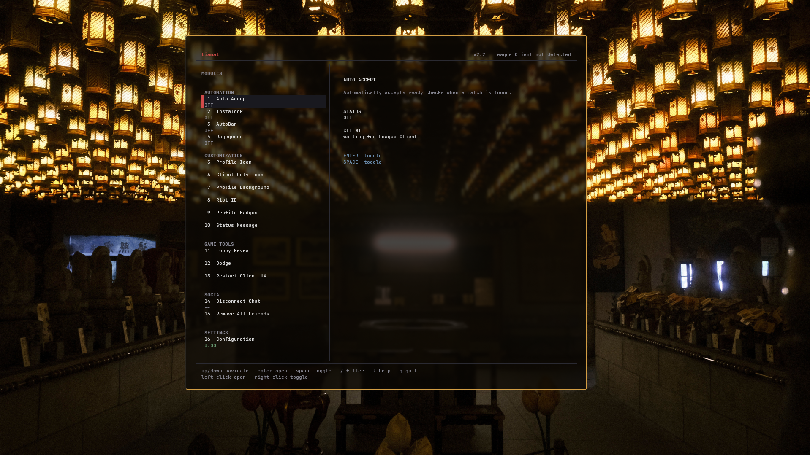

# Tiamat for Linux

A fork of [Tiamat](https://github.com/369gabriel/tiamat) by [369gabriel](https://github.com/369gabriel) that runs on Linux, against the macOS League of Legends client running under [darling-lol](https://github.com/lucannez64/darling-lol).

Tiamat is a keyboard-first terminal application that provides utility functions for the League of Legends client. It is inspired by [KBotExt](https://github.com/KebsCS/KBotExt/), by Kebs. Everything below the install section works the same as upstream. This fork changes how the client is found and makes the interface use your terminal's background.



## ⚠️ Important Notice
Use at your own risk, as some features might violate Riot Games' Terms of Service. Running League through Darling carries its own ban risk, so consider using an account you can afford to lose.

## What's different from upstream
* **Client detection under Darling.** Darling names the client processes after threads (`CrBrowserMain`, `mldr`), not `LeagueClientUx.exe`, so Tiamat finds the client by its executable path instead. If the command line doesn't carry the LCU port and token, Tiamat reads the lockfile in `$DPREFIX/Applications/League of Legends.app/Contents/LoL/` (default `~/.darling`).
* **Transparent background.** Tiamat uses the terminal's own background, so translucent terminals show through.
* **No `uv` needed.** `run-linux.sh` creates a virtualenv with the system Python.

The detection change is proposed upstream in [369gabriel/tiamat#5](https://github.com/369gabriel/tiamat/pull/5).

## 🌟 Features

### Customization
* Icon Changer
  * Icon Changer (Icons 1-100)
  * Client Only (All Available Icons)
* Profile Background Changer
* Riot ID Changer

### Game Automation
* Auto Accept Match
* Ragequeue with selectable lobby type
* Autopick Champion
  * Optional fallback champion when the main pick is banned, taken, or unavailable
* Autoban Champion
* Smart Dodge (Avoid client restart)

### Utility
* Lobby Reveal
* Restart Client UX
* Disconnect from chat (toggle offline)

## 🚀 Installation

### Prerequisites
- Linux (tested on Arch) with Python 3.10 or higher
- League of Legends running through [darling-lol](https://github.com/lucannez64/darling-lol)
- Git

### Quick Start
```bash
git clone https://github.com/tropical-luv/tiamat.git
cd tiamat
./run-linux.sh
```

The first run creates `.venv` and installs the dependencies. If your Darling prefix isn't `~/.darling`, export `DPREFIX` first, the same way darling-lol uses it.

Run the tests with:
```bash
.venv/bin/python -m pytest
```

## 💡 Usage

### First Time Setup
1. Start Tiamat.
2. Start League through darling-lol, before or after Tiamat.
3. Wait until the top right shows `connected` with your Riot ID. Modules can't be switched on until then.
4. Select a module with the arrow keys, the mouse, or its number shortcut.

### Keyboard Shortcuts

| Key | Action |
| --- | --- |
| `Up` / `Down` or `j` / `k` | Navigate modules |
| `Enter` | Open or run the selected module |
| `Space` | Toggle the selected automation |
| `/` | Search modules |
| `1` through `16`, then `Enter` | Open or run a module directly |
| `99`, then `Enter` or `q` | Exit |
| `Esc` | Close a form or confirmation |
| Left click | Open or run a module |
| Right click | Toggle an automation |


### Module Guide

| Number | Category | Module |
| --- | --- | --- |
| `1` | Automation | Auto Accept |
| `2` | Automation | Instalock |
| `3` | Automation | AutoBan |
| `4` | Automation | Ragequeue |
| `5` | Customization | Profile Icon |
| `6` | Customization | Client-Only Icon |
| `7` | Customization | Profile Background |
| `8` | Customization | Riot ID |
| `9` | Customization | Profile Badges |
| `10` | Customization | Status Message |
| `11` | Game Tools | Lobby Reveal |
| `12` | Game Tools | Dodge |
| `13` | Game Tools | Restart Client UX |
| `14` | Social | Disconnect Chat |
| `15` | Social | Remove All Friends |
| `16` | Settings | Configuration |

Configuration forms validate input inline. Destructive actions require confirmation before execution, and network work runs in the background so the interface remains responsive.

Ragequeue supports League queues plus TFT Normal, Ranked, Hyper Roll, and Double Up.

Configuration supports Porofessor, OP.GG, and U.GG for Lobby Reveal, plus independent `0-2s` delays for Auto Accept, Instalock, and AutoBan.

Instalock lets you select a main champion and an optional fallback. The fallback is disabled by default and can be cleared by selecting **Disabled**. If neither champion is available, Tiamat notifies you to pick manually.

## 📫 Support
Problems specific to Linux or Darling: open an [issue on this fork](https://github.com/tropical-luv/tiamat/issues).
Everything else: see [upstream Tiamat](https://github.com/369gabriel/tiamat).

## 🙏 Acknowledgments
* [369gabriel](https://github.com/369gabriel) for Tiamat
* [KBotExt](https://github.com/KebsCS/KBotExt/) by Kebs for the original inspiration
* [darling-lol](https://github.com/lucannez64/darling-lol) for making League run on Linux

## License
GPL-3.0, like upstream. This fork modifies the original; changes are listed above and in the commit history (since 2026-10-18).
